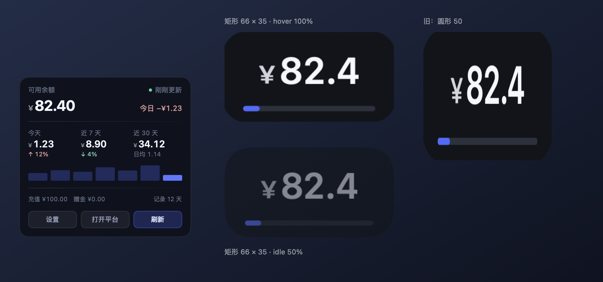
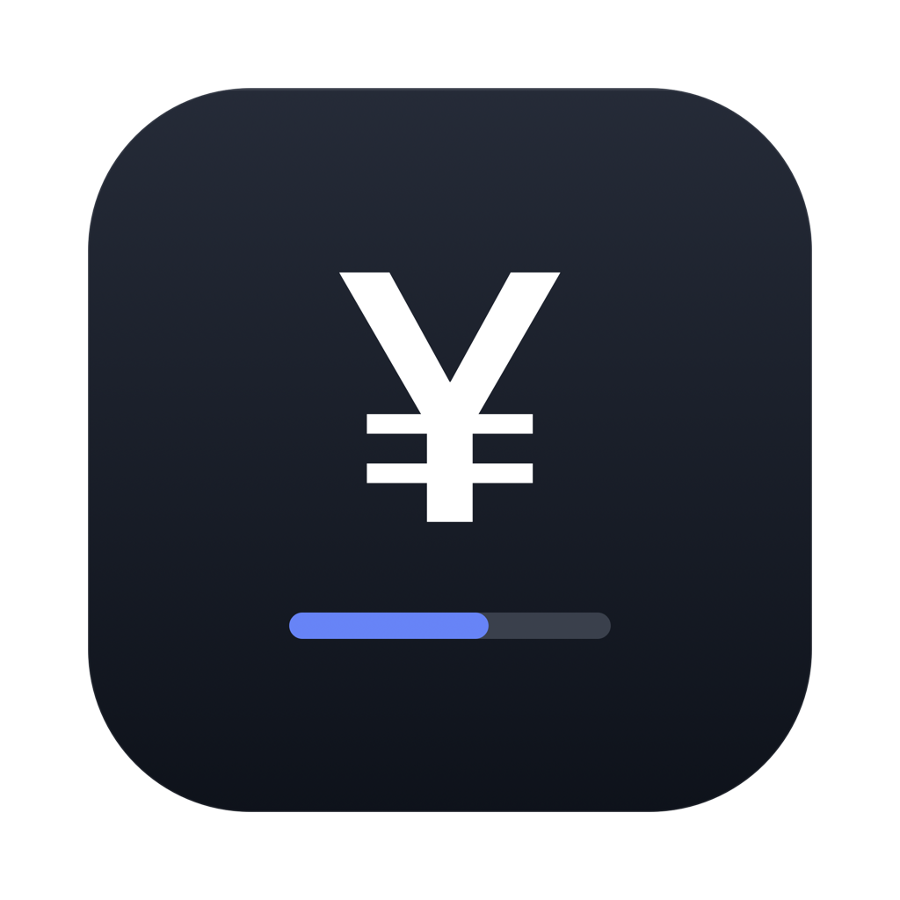

# DeepSeek Meter

一个常驻 macOS 桌面的 66×35 悬浮挂件：显示 DeepSeek 余额，悬停展开今天 / 近 7 天 / 近 30 天的消耗（人民币）。





- 扁平墨片挂件 + 底部进度条（进度 = 今日花费 / 日预算）；66×35，高度可选 31 / 35 / 39
- 静止 50% 不透明度，悬停 / 卡片展开时 100%
- 悬停 120ms 展开卡片；点击固定（多出 设置 / 打开平台 / 刷新）
- 双击打开设置，右键出菜单，⌥⌘H 显隐，拖动后自动吸附屏幕边缘
- 不用 Xcode：SwiftPM + 脚本组装 `.app`，ad-hoc 签名

## 运行

```bash
./scripts/build_app.sh release                    # 产物：build/DeepSeek Meter.app
cp -R "build/DeepSeek Meter.app" /Applications/   # 想常驻就装到 /Applications
open "/Applications/DeepSeek Meter.app"
```

> 直接跑 `build/` 里的副本时，Finder 可能缓存了旧的通用图标；装到 `/Applications` 后图标会正常显示。

首次启动会要求粘贴 API Key（只读接口）。没有 Key 时挂件显示 `···`。

输入框支持 **⌘V**（App 内挂了一个隐藏的「编辑」菜单，LSUIElement 的 App 默认没有它，
⌘V/⌘C/⌘A 会失效），右侧还有一个「粘贴」按钮，点一下就能把剪贴板内容填进去。

调试模式（内置假数据，不联网、不读钥匙串）：

```bash
"build/DeepSeek Meter.app/Contents/MacOS/DeepSeekMeter" --demo
```

其他开发开关：

| 参数 | 作用 |
| --- | --- |
| `--demo` | 用假数据启动，方便看 UI |
| `--selftest` | 启动后自动展开并固定卡片、打开设置，打印状态日志 |
| `--render <path>` | 离线渲染卡片 + 挂件（100% / 50%）到一个 PNG，不需要屏幕权限 |
| `--debug-widget <path>` | 只渲染一个大号挂件，检查字号与进度条 |
| `--stats-test` | 造 14 天临时采样（含充值与赠金过期），验证聚合口径 |
| `DSB_FAKE_KEY=...` | 用环境变量里的 Key 覆盖钥匙串（只读，不落盘） |
| `DSB_TEST_KEYCHAIN=1` | 启动时做一次钥匙串写入/读取/删除自检 |

## 数据与口径

`GET https://api.deepseek.com/user/balance` 是官方唯一可用的余额接口，**没有按天用量接口**，
所以用量是**余额差值估算**：

- 每 N 分钟（默认 5）采一次余额，写入 SQLite（`~/Library/Application Support/DeepSeekMeter/usage.db`）
- `Δ = 上次 − 本次`；`Δ > 0` 记为消耗，归属到本次采样所在的自然日
- `Δ < 0` 视为充值 / 退款，不计入消耗（充值不会污染花费）
- 例外：赠金过期同样是余额下降，仅凭余额分不出来，按消耗计
- 今天 / 7 天 / 30 天 = 日桶求和；不足 30 天时卡片显示「记录 N 天」

误差来源：两次采样之间的消耗会整段归到采样时刻那天，跨零点最多错一个采样间隔。

失败重试：`15s → 30s → 60s → 120s → 300s`，成功后重置；`401` 直接进入错误态，不再退避重试。

## 交互一览

| 操作 | 结果 |
| --- | --- |
| 悬停挂件 120ms | 展开卡片（离开挂件 + 卡片 300ms 后收起） |
| 点击挂件 | 固定 / 取消固定卡片（固定后多一行操作按钮） |
| 双击挂件 | 打开设置 |
| 右键挂件 | 刷新 / 固定 / 设置 / 打开平台 / 隐藏 / 退出 |
| 拖动挂件 | 移动；松手后吸附到最近的左/右边缘，位置持久化 |
| ⌥⌘H | 显示 / 隐藏挂件 |
| 菜单栏图标 | 同样的菜单入口（挂件隐藏后依然可以找回） |

## 结构

```
Sources/DeepSeekMeter/
  App.swift        入口 + CLI 开关
  AppDelegate.swift 窗口/菜单/快捷键/悬停与吸附
  Panels.swift     双窗口（挂件、卡片）、鼠标容器、摆位算法
  Views.swift      挂件、卡片、设置、引导（SwiftUI）
  AppModel.swift   轮询、状态机、聚合、格式化
  Model.swift      Prefs / Keychain / 余额接口 / SQLite
  Render.swift     离线渲染（设计比对用）
Resources/Info.plist
Resources/AppIcon.icns     图标（1024 母版由 scripts/make_icon.swift 生成）
scripts/build_app.sh
```

双窗口是刻意的：挂件窗口固定尺寸，卡片单独一个窗口出现/消失，避免 hover 时改变挂件窗口尺寸导致
的 tracking 抖动与点击穿透。

## 已知限制

- **没有公证，ad-hoc 签名**：换机器或重新下载会被 Gatekeeper 拦；本机直接 `open` 即可
- **Key 不用钥匙串**：ad-hoc 签名每次重建 cdhash 都变，钥匙串 ACL 会反复弹「想使用你的机密信息」并要
  登录密码，所以改成 `~/Library/Application Support/DeepSeekMeter/api.key`（0600）。正式签名分发时可以换回钥匙串
- **开机自启**：用 `SMAppService.mainApp`，未放入 `/Applications` 或签名不被系统认时可能失败，设置里会给出提示
- **1× 非 Retina 屏**：2.5px 的环会接近一条细线，设计按 Retina 取值
- **用量是估算**，页面底部有说明；官方精确值需要抓 `platform.deepseek.com` 的登录态，未做
- 未做多账号、USD 账户的汇率换算（USD 账户只改符号）
